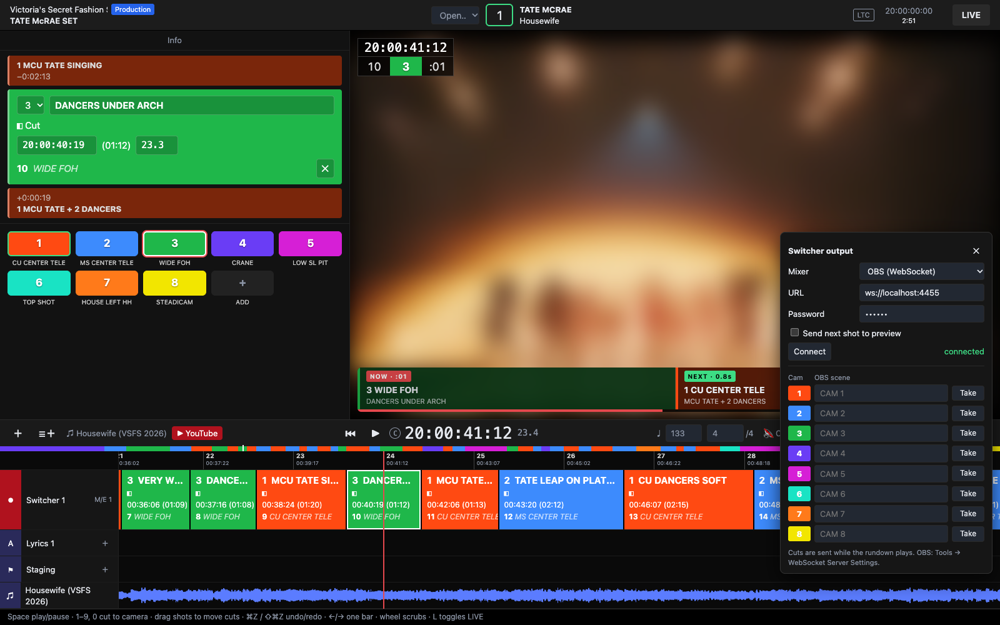
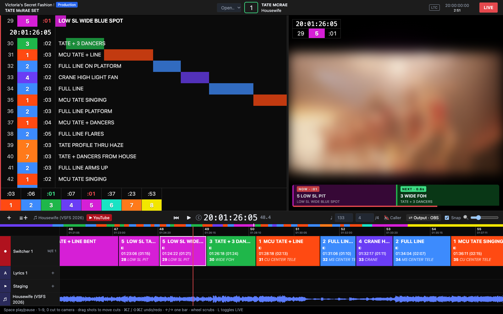
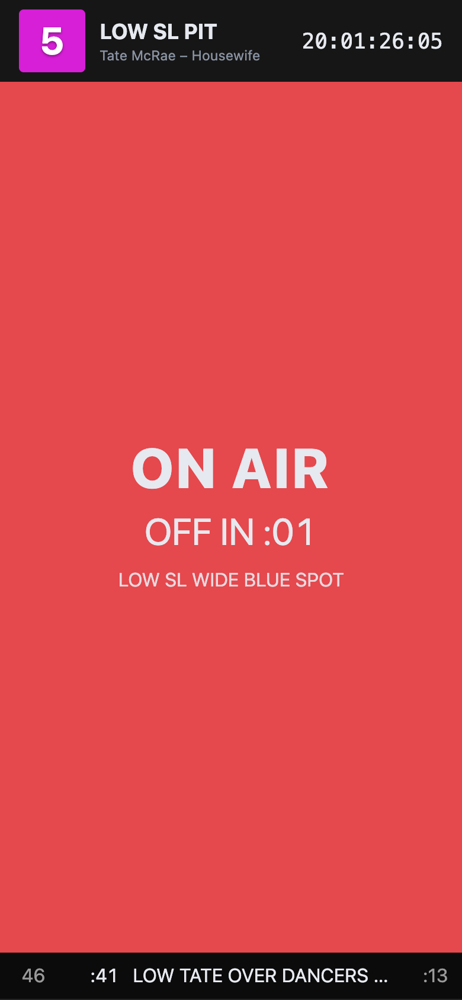

# Rundown

A browser-based camera rundown for music performances in live TV. Plan every camera cut against **timecode** and **musical bars/beats**, then run the show from a **LIVE** view with a scrolling shot waterfall, per-camera countdowns and the program video beside it.

Built with Vue 3 and Vite. No separate backend: the Vite dev server also downloads reference videos and relays the clock to camera operator devices.

> Inspired by professional show-calling tools such as [LiveEdit](https://liveedit.app) and [CuePilot](https://www.cuepilot.com). This is an independent hobby project. It is not affiliated with, endorsed by or connected to either product or company. All product names and trademarks belong to their respective owners.

## Screenshots

All screenshots show the example rundown for Tate McRae's "Housewife" ([see below](#example-reverse-engineered-shot-list)). The performance video is blurred on purpose.

**Editor**: shot info, camera buttons, program monitor and track timeline, with the switcher **Output** panel connected to OBS.



**LIVE**: the shot waterfall with sliding duration bars, per-camera countdowns, and the program monitor with a NOW/NEXT bar.



**Camera operator view** (`/#cam=5` on a phone): the tally follows the director's window live. It's red while on air, green on standby and dark when clear, with the operator's upcoming shots underneath.



<sub>Video frames (blurred): Tate McRae – 2026 Victoria's Secret Fashion Show Performance, © 2026 RCA Records / Sony Music Entertainment. Shown for illustration only.</sub>

## Features

- **Cut list on timecode and music**: each shot is a cut to a camera that runs until the next cut. Edit a shot by SMPTE timecode (25 fps, with an LTC start offset) or by `bar.beat`, using the song's BPM and time signature.
- **Timeline editor**: switcher track with LiveEdit-style shot blocks, a bar/timecode ruler, an overview strip, lyrics and note tracks, and an audio waveform. The playhead stays fixed while the content scrolls under it.
- **Live cutting**: press `1`–`9` / `0` or click a camera button to cut at the playhead, optionally snapped to the beat.
- **Timeline editing**: drag a shot to move its cut (snapped to the beat, kept between its neighbours), with undo/redo.
- **LIVE mode**:
  - a waterfall list of upcoming shots whose colored bars slide toward the now-line
  - a countdown for every camera to its next shot
  - a program monitor with a timecode/shot overlay and a NOW/NEXT bar with a progress bar
  - a draggable divider between the list and the video
- **Camera operator view**: `/#cam=3` on a phone or tablet shows one operator's tally (ON AIR / STANDBY · NEXT / CLEAR), a countdown and their upcoming shots, synced live from the director's window.
- **Switcher output**: sends the planned cuts to **OBS** (WebSocket v5, with password) or **vMix** (HTTP API) while the rundown plays, and optionally the next shot to preview.
- **Caller**: a spoken PA call at each cut ("Five. Next, three.") and a "3, 2, 1" count before longer shots, one voice at a time.
- **Media**: load a local audio file or a reference video. The video drives the show clock, so picture and UI never drift apart.
- **YouTube import** (dev server only): paste a link and the server downloads it with `yt-dlp`.
- **Rundown files**: every `src/shows/*.json` appears in the **Open…** menu. Your edits autosave to the browser's `localStorage`.

## Quick start

```bash
npm install
npm run dev
```

Open http://localhost:5173. A demo show loads by default.

The YouTube import also needs:

```bash
brew install yt-dlp ffmpeg
```

## Keyboard

| Key | Action |
| --- | --- |
| `Space` | Play / pause |
| `1`–`9`, `0` | Cut to camera 1–10 at the playhead |
| `←` / `→` | Jump one bar |
| `Home` | Back to start |
| `⌘Z` / `⇧⌘Z` | Undo / redo |
| `L` | Toggle LIVE mode |
| Mouse wheel on timeline | Scrub |

## Camera operator view

Run the dev server on your network, then open a camera's view on each operator's device:

```bash
npm run dev:lan
```

```
http://<your-mac's-ip>:5173/#cam=3
```

The director's window (the normal view) publishes the rundown and clock about 10 times a second over the dev server's WebSocket. Camera views only follow. Keep the director's window in front: browsers slow down background tabs, which pauses the clock updates.

`dev:lan` makes the whole dev server, including the YouTube download endpoint, reachable from your local network. Only use it on networks you trust.

## Switcher output

Open **⇄ Output** in the toolbar, pick the mixer and map each camera to an OBS scene or a vMix input (the default is `CAM <n>`). **Take** cuts to a camera immediately, for testing. During playback, every change of the on-air camera is sent to the mixer.

- **OBS**: enable *Tools → WebSocket Server Settings*. The default URL is `ws://localhost:4455`. The password is kept in memory only. "Send next shot to preview" needs Studio Mode.
- **vMix**: enable *Settings → Web Controller*. The default URL is `http://localhost:8088`. Calls are fire-and-forget (vMix sends no CORS headers), so a wrong input name fails silently in vMix.

## Deep links

Open a rundown at a moment, optionally in LIVE mode:

```
http://localhost:5173/#live&show=Tate%20McRae%20%E2%80%93%20Housewife&t=86.2
```

`show` is the name shown in the **Open…** menu, and `t` is the time in seconds.

## Rundown format

A rundown is plain JSON. See [`src/shows/housewife.json`](src/shows/housewife.json):

```jsonc
{
  "title": "Housewife", "artist": "Tate McRae",
  "bpm": 133, "beatsPerBar": 4, "duration": 171.2,
  "tcOffset": 72000,               // LTC start, seconds (20:00:00:00)
  "media": { "file": "/media/housewife.mp4" },
  "cams": [{ "id": 1, "name": "CU CENTER TELE", "color": "#ff4a12" }],
  "cues": [{ "id": 1, "start": 0, "cam": 4, "note": "CRANE PUSH THRU DANCERS TO STAGE" }],
  "tracks": [{ "id": 2, "name": "Staging", "kind": "note", "items": [{ "id": 1, "start": 0, "text": "Dark open" }] }]
}
```

### Examples: reverse-engineered shot lists

Two rundowns ship as examples: Tate McRae's "Housewife" (below), and Parov Stelar's "Black Lilies", the interval act of the Eurovision Song Contest 2026 Grand Final in Vienna ([`black-lilies.json`](src/shows/black-lilies.json): 9 cameras, 43 shots, 125 BPM, including dissolves and long single-take crane and Steadicam shots).

### Example: reverse-engineered shot list

`housewife.json` maps the camera plan of Tate McRae's "Housewife" performance at the 2026 Victoria's Secret Fashion Show from the published broadcast:

- **Cuts:** found with ffmpeg scene detection.
- **Song boundaries:** found from the audio levels.
- **Tempo and beat phase:** 133 BPM, from onset analysis.
- **Camera positions:** inferred by grouping the shots by framing. They are an interpretation of the edit, not the production's real camera plot.

The video itself is **not** included. To recreate `media/housewife.mp4` locally:

```bash
yt-dlp -f "bv*[ext=mp4][height<=720]+ba[ext=m4a]" --merge-output-format mp4 -o media/full.mp4 "https://www.youtube.com/watch?v=uo4JWL45ESY"
ffmpeg -ss 1.0613 -to 172.24 -i media/full.mp4 -c:v libx264 -c:a aac media/housewife.mp4
```

## How it works

- **One clock.** A `requestAnimationFrame` loop in [`src/store.js`](src/store.js) writes a single reactive `clock.now`. When media is loaded it reads `video.currentTime`, so the decoder is the master clock.
- **Everything else is derived.** Shot end times come from the next cut, and the on-air shot is `findLastIndex(start <= now)`. Program, preview, countdowns and tally colors all derive from those two values.
- **No scroll state.** Timeline items are positioned with `calc(30% + (start - now) * zoom px)`, so the browser does the layout. Only items inside a time window around the playhead are rendered.
- **Waveform.** `decodeAudioData` runs once into a peaks array (50 per second). A canvas redraws only the visible pixels each frame.
- **One `<video>` element** is created once and moved between views, so switching views never re-buffers.
- **YouTube import.** [`vite.config.js`](vite.config.js) adds a middleware that runs `yt-dlp` with an argument array (no shell) and accepts only https YouTube URLs.

## Limitations

- The YouTube import and camera-view sync run only with the dev server. A static build has no server to call.
- Sync is last-writer-wins. Run one director window per show.
- Edits live in browser storage only. There's no export or sync yet.
- Downloaded videos are copyrighted by their owners and are excluded from the repo (`media/` is git-ignored). Respect YouTube's Terms of Service and only download content you have the rights to use.
