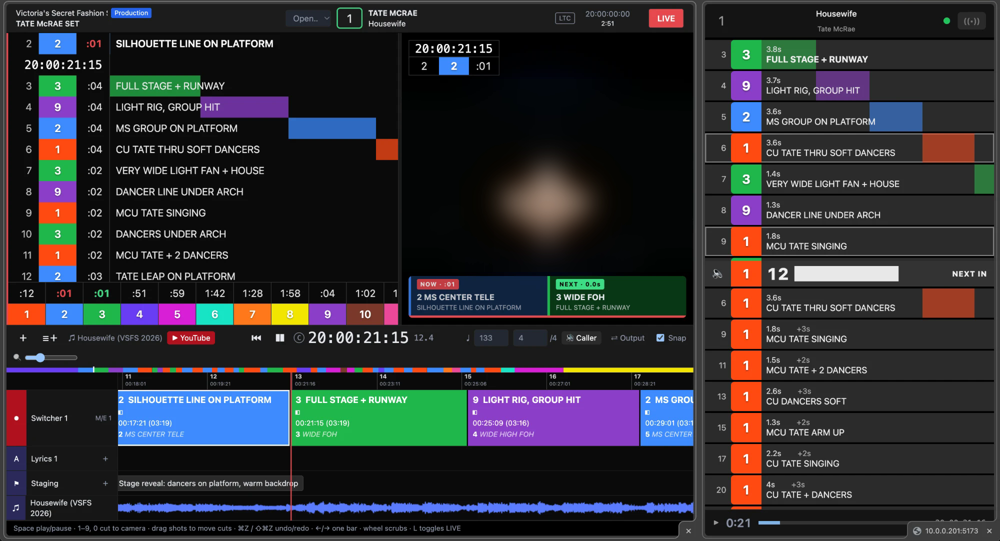
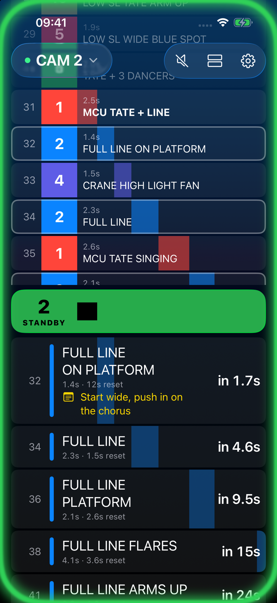
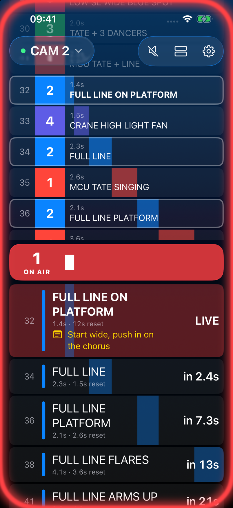
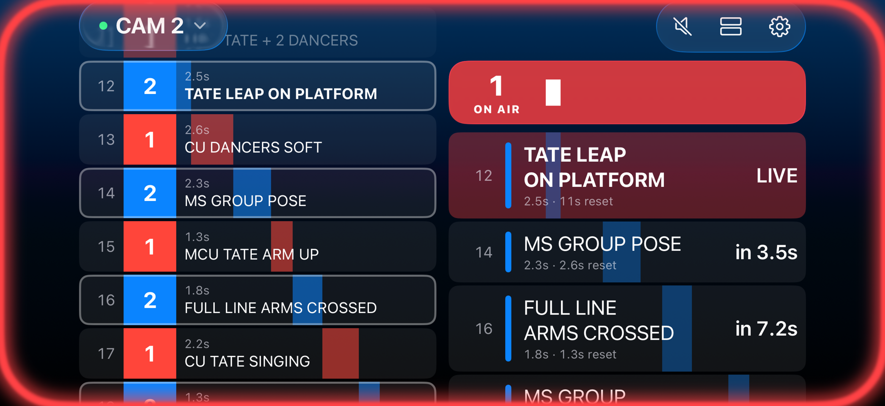
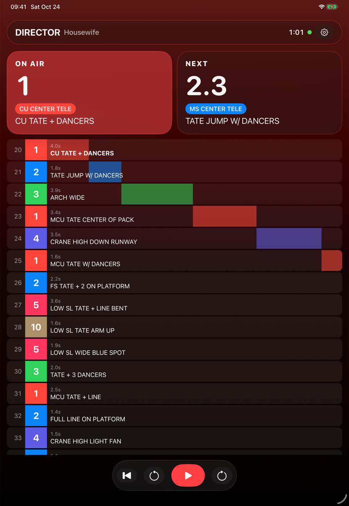
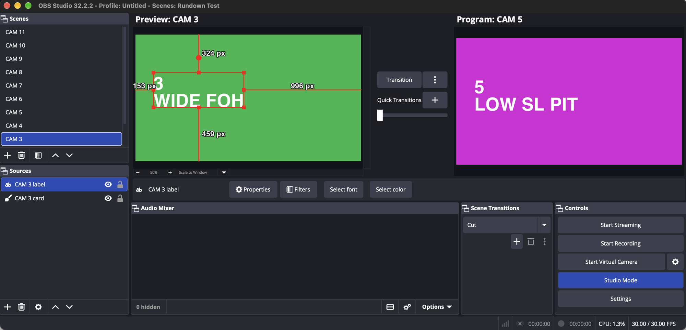

# Rundown

A browser-based camera rundown for music performances in live TV. Plan every camera cut against **timecode** and **musical bars/beats**, then run the show from a **LIVE** view with a scrolling shot waterfall, per-camera countdowns and the program video beside it.



<sub>Tate McRae's "Housewife" at 20:01:31:19 with camera 2 on air: the director's LIVE view in the browser (left) and the iPhone app as camera 2's operator view (right), synced over the network.</sub>

Built with Vue 3 and Vite, plus a small Node server ([`server/`](server)) for director logins, camera join codes, clock sync and YouTube downloads.

**Vibe-coded and open source.** The web app and the iOS app were built by describing what they should do to an AI coding assistant ([Claude Code](https://claude.com/claude-code)), reviewing the result in the running app, and iterating. The code is MIT-licensed ([see below](#license)): use it, fork it, learn from it. Expect rough edges, and test it yourself before you take it near a real show.

> Inspired by professional show-calling tools such as [LiveEdit](https://liveedit.app) and [CuePilot](https://www.cuepilot.com). This is an independent hobby project. It is not affiliated with, endorsed by or connected to either product or company. All product names and trademarks belong to their respective owners.

## Screenshots

All screenshots show the example rundown for Tate McRae's "Housewife" ([see below](#example-reverse-engineered-shot-list)). The performance video is blurred on purpose.

### iPhone camera operator app

Camera 2 just before and during its shot 32. **Standby** (left): camera 2 is next, so the screen edge glows green and the countdown bar runs down to the cut. **On air** (right): the glow turns red and the shot is marked LIVE. The yellow line is the operator's own note on that shot.

<p>


</p>

- **Top:** the whole cut flow, scrolling up under the floating header.
- **Middle:** the countdown to this camera's next cut, or the time left on air. Drag it to resize the two lists; it snaps to the middle of the screen.
- **Below:** only this camera's shots, with the time to reposition between them. Every bar shares one playhead.

Tap a shot to write notes on it, and tap the camera in the header to switch cameras.

**Landscape**: the cut flow on the left, the countdown and this camera's shots on the right.



### Browser

**Editor**: shot info with the previous and next shot, camera buttons, program monitor and track timeline.


**LIVE**: the shot waterfall with sliding duration bars, per-camera countdowns, and the program monitor with a NOW/NEXT bar.


**Camera operator view** (`/#cam=2&code=…` on a tablet, CuePilot-style): the same layout as the iPhone app, following the director's window live.


<sub>Video frames (blurred): Tate McRae – 2026 Victoria's Secret Fashion Show Performance, © 2026 RCA Records / Sony Music Entertainment. Shown for illustration only.</sub>

## Features

- **Cut list on timecode and music**: each shot is a cut to a camera that runs until the next cut. Edit a shot by SMPTE timecode (25 fps, with an LTC start offset) or by `bar.beat`, using the song's BPM and time signature.
- **Timeline editor**: switcher track with LiveEdit-style shot blocks, a bar/timecode ruler, an overview strip, lyrics and note tracks, and an audio waveform. The playhead stays fixed while the content scrolls under it.
- **Live cutting**: press `1`–`9` / `0` or click a camera button to cut at the playhead, optionally snapped to the beat.
- **Timeline editing**: drag a shot to move its cut (snapped to the beat, kept between its neighbours), with undo/redo.
- **LIVE mode**:
  - a waterfall list of upcoming shots whose colored bars slide toward the now-line
  - a countdown for every camera to its next shot
  - a program monitor with a timecode/shot overlay and a NOW/NEXT bar with a progress bar
  - a draggable divider between the list and the video
- **Camera operator view**: `/#cam=3&code=<join code>` on a tablet or phone shows the cut flow, this camera's countdown bar (ON AIR / STANDBY / NEXT IN) and its own shots with repositioning time. It has an optional spoken "3, 2, 1" and a sync indicator, and follows the director's window live.
- **iPhone and iPad app**: a native camera operator view, and a director remote with play, pause and seek ([see below](#iphone-and-ipad-app)).
- **Switcher output**: sends the planned cuts to **OBS** (WebSocket v5, with password) or **vMix** (HTTP API) while the rundown plays, and optionally the next shot to preview. It reads the mixer's program back (tally) and warns when it leaves the plan.
- **Chase timecode**: the show clock follows house **LTC** or **MTC**, read by the server on the show machine, or by the director's browser as a fallback ([see below](#chase-timecode)).
- **Rehearsal take**: with **Rec** on, cuts go into a take beside the plan, from the camera keys or from the vision mixer. Compare the two, then accept the take ([see below](#rehearsal-take)).
- **Note to cameras**: a note per performance (e.g. "Cam 4 swap to wide lens after this song") shown at the top of every browser camera view.
- **Caller**: a spoken PA call at each cut ("Five. Next, three.") and a "3, 2, 1" count before longer shots, one voice at a time.
- **Media**: load a local audio file or a reference video. The video drives the show clock, so picture and UI never drift apart.
- **YouTube import**: paste a link and the server downloads it with `yt-dlp`.
- **Productions, rundowns, performances**: after login you pick a production (e.g. a song contest), one of its rundowns (e.g. Semi Final 1), then a performance in its running order. The header shows where you are, and `‹ ›` (or `⌥←` / `⌥→`) switch to the previous or next performance; camera views follow the switch.
- **Production cameras**: a production has one camera list (number, name, color, operator, position), edited on its screen and shared by all its performances. Renaming or adding a camera in the editor changes it for the whole production. Camera numbers never shift: removing one leaves a gap.
- **Rundown files**: every `src/shows/*.json` is one of the example performances under **Examples › Songs**. Your edits autosave to your account on the server, so they follow you between devices.

## Quick start

```bash
npm install
npm run dev
```

Open http://localhost:5173. The first visit asks you to create the director account. After that, sign-up is closed, and more directors are added from the command line:

```bash
npm run user add jane@example.com
```

It prints a random password once. `npm run dev` also keeps a fixed local login for `dev@rundown.localhost` (password `Password123`, see `server/index.js`); `npm start` doesn't. A demo show loads by default. Accounts, logins and each director's rundown live in `data/rundown.db` (SQLite, git-ignored). Needs Node 22.13 or later.

The YouTube import also needs:

```bash
brew install yt-dlp ffmpeg
```

### The whole demo in Docker

One command starts Rundown, the server, a timecode generator and a playback machine that follows it:

```bash
docker compose up
```

- **Rundown** on http://localhost:5173, logged in as `dev@rundown.localhost` / `Password123`. Phones and tablets on your network can join as cameras.
- **Timecode and playback** on http://localhost:5175 (this machine only): play, pause, jump and locate the timecode, and below that, pick a track and its start time and it plays along.

The timecode starts paused at 19:59:55:00, a 5 s countdown into the example songs at 20:00:00:00. `MTC_START=23:59:55:00 docker compose up` counts down into a song at 00:00:00:00 instead. Rundown follows the generator's MTC over its websocket, since containers have no MIDI ports. Downloaded videos go to `./media`, accounts and rundowns to a Docker volume.

## Keyboard

| Key | Action |
| --- | --- |
| `Space` | Play / pause |
| `1`–`9`, `0` | Cut to camera 1–10 at the playhead |
| `←` / `→` | Jump one bar |
| `⌥←` / `⌥→` | Previous / next performance in the rundown |
| `Home` | Back to start |
| `⌘Z` / `⇧⌘Z` | Undo / redo |
| `L` | Toggle LIVE mode |
| Mouse wheel on timeline | Scrub |

## Camera operator view

The director's header shows a join code next to the LIVE button, for example **Join YBCUCB**. Click it to copy the camera link, or give operators the code:

```
http://<server>:5173/#cam=3&code=YBCUCB
```

Opening `/#cam=3` without a code asks for one. Camera views only listen: they can't change the rundown or the clock. Each director account is its own room, and the server stores its rundown, so cameras see the shot list even before the director is online.

The director's window publishes the rundown and clock about 10 times a second. Camera views follow it, and they add the network delay, which they measure against the server clock. Keep the director's window in front: browsers slow down background tabs, which pauses the clock updates.

The server listens on every network interface, so devices on your network can reach it directly.

## Hosting

```bash
npm run build
npm start
```

`npm start` serves the built app from `dist/` with the same API and sync. Settings:

- `PORT` (default 5173)
- `DATA_DIR` (default `data`)

Put it behind an HTTPS proxy (Caddy, nginx, or a platform like Fly.io) that sets `X-Forwarded-Proto`, so the login cookie is marked `Secure`. Install `yt-dlp` and `ffmpeg` on the server if you want YouTube import. Many video sites block downloads from cloud servers, though.

For a real show, run the same server on a machine in the production network instead. Then the show doesn't depend on the venue's internet.

## iPhone and iPad app

`ios/` holds a native SwiftUI app (iOS 26, Liquid Glass) that follows the director's window through the same server as the browser camera views. The web director stays the host. Tap the camera in the header to pick a camera or the director remote:

- **Camera**: the waterfall from the browser camera view, or a card layout with a big countdown. The screen edge glows green on standby and red on air. Tap a shot to write notes on it; they stay on the device and show in this camera's list. Turn the phone sideways for a side-by-side layout.
- **Director remote**: for a director on the move with an iPad. It shows what is on air and next, plus the whole cut flow. Play, pause, jump one bar, or tap a shot to jump there. The director's browser window carries out each command.

Both shot lists scroll on their own, and **Back to live** returns them to the shot on air.



<sub>Director remote on an iPad Pro 11".</sub>

Open `ios/CamOp.xcodeproj` in Xcode 26 or later, pick your team under *Signing & Capabilities*, and run it. In the app's settings (gear icon), enter the server, for example `192.168.1.10:5173` on your network or `rundown.example.com` for an HTTPS host. Then enter the join code. The director remote needs the director's email and password instead. iOS asks for local network access the first time. The Xcode project is generated from `ios/project.yml` with [XcodeGen](https://github.com/yonaskolb/XcodeGen) (`cd ios && xcodegen generate`).


## Switcher output

Open **⇄ Output** in the toolbar, pick the mixer and map each camera to an OBS scene or a vMix input (the default is `CAM <n>`). **Take** cuts to a camera immediately, for testing. During playback, every change of the on-air camera is sent to the mixer.



<sub>OBS 32 in Studio Mode, driven by the "Housewife" rundown: camera 5 on Program, the next shot (camera 3) waiting in Preview, and the transition set to Cut. The scenes are plain color cards named `CAM 1`–`CAM 11`.</sub>

- **OBS**: enable *Tools → WebSocket Server Settings*. Connecting sets the OBS transition to **Cut**, so planned cuts land on the frame. After every cut, the next shot is put back into Preview, because OBS moves the previous Program scene there. The default URL is `ws://localhost:4455`. The password is kept in memory only. "Send next shot to preview" needs Studio Mode.
- **vMix**: enable *Settings → Web Controller*. The default URL is `http://localhost:8088`. Calls are fire-and-forget (vMix sends no CORS headers), so a wrong input name fails silently in vMix. For tally, the server reads vMix's state 4 times a second, so the URL must be reachable from the server.

**Tally**: the panel shows which camera the mixer has on program, the camera buttons mark it with a red dot, and the monitor shows **MIXER ON 3 · PLAN 5** when the program differs from the plan for more than half a second. Turn off **Send planned cuts** to only listen, for example to record a vision mixer's rehearsal.

## Chase timecode

### On the server (recommended for a show)

Run the server on the show machine with the house timecode plugged into it:

```bash
CHASE=ltc npm start
```

- `CHASE=ltc` reads LTC from an audio input through `ffmpeg` (installed for YouTube import anyway). By default it uses the first input: `-f avfoundation -i :0` on a Mac, `-f alsa -i default` on Linux. `CHASE_INPUT` replaces those ffmpeg input arguments, for example `CHASE_INPUT="-f avfoundation -i :2"`. `ffmpeg -f avfoundation -list_devices true -i ""` lists the Mac's inputs.
- `CHASE=mtc` reads MIDI timecode from a MIDI input through the optional `@julusian/midi` package. `CHASE_INPUT` picks the first port whose name contains it, for example `CHASE_INPUT="IAC"`. Without it, the server opens the first port.
- No house timecode to test with? `npm run mtc [hh:mm:ss:ff]` sends 25 fps MTC from a virtual MIDI port and on its websocket (`CHASE_INPUT=ws://localhost:5175/midi`), from 20:00:00:00 by default (add `-- --paused` to start paused). Start it first, then `CHASE=mtc CHASE_INPUT="Rundown MTC" npm run dev`, and play, pause, jump and locate on http://localhost:5175. Below the controls, that page is also a playback machine: pick a track and its start time, and it plays while MTC rolls. Or run all of it with `docker compose up` ([see above](#the-whole-demo-in-docker)).

The server sends every frame, stamped with its own clock, to every director window and camera view. They all run their clock from it directly, so no browser tab has to stay in front and a takeover doesn't interrupt it. There is one house clock per show machine, so every account on the server follows it. A director window working on a performance of its own (not the live one) keeps its own transport, so you can still scrub while editing during a show. The **Chase** button reads **SERVER LTC** or **SERVER MTC** while the server chases.

### In the browser (fallback)

When the server doesn't chase, for example when it's hosted in the cloud, the active director window can read the timecode itself. Open **Chase** in the toolbar and pick a source:

- **MIDI timecode (MTC)**: from any MIDI input, or one you pick. Needs Chrome, Edge or Firefox (Web MIDI). Quarter frames roll the clock, and a full-frame message locates it.
- **LTC on an audio input**: plug house LTC into an audio interface input. The browser asks for microphone access, and echo cancelling and gain control are turned off.

Either way, while chasing, house timecode runs the show: play, pause and seek do nothing, and the video follows it muted. The song starts at the **LTC** start time in the header. Nothing plays before that or after the song ends, and the clock stops when timecode stops. The button turns red when no frames arrive. Frame rates 24, 25 and 30 are detected. 29.97 drop-frame is read as 30, and reverse play isn't supported.

## Rehearsal take

Press **Rec** in the toolbar. Camera keys and buttons now cut into the **Rehearsal** track under the switcher track instead of changing the plan. With the switcher output on listen only, the vision mixer's cuts are recorded too. Pressing play again records over the take from that point. Shots that differ from the plan are outlined in white.

**Accept** replaces the plan with the take over the stretch that was recorded, keeping the plan's shot notes where the same camera cuts within 2 seconds. ⌘Z undoes it. The take lives in that window only, so a reload drops it.

## Deep links

Open a rundown at a moment, optionally in LIVE mode:

```
http://localhost:5173/#live&show=Tate%20McRae%20%E2%80%93%20Housewife&t=86.2
```

`show` is the example's name (`<artist> – <title>`, as listed under **Examples › Songs**), and `t` is the time in seconds.

## Rundown format

A rundown is plain JSON. See [`src/shows/housewife.json`](src/shows/housewife.json):

```jsonc
{
  "title": "Housewife", "artist": "Tate McRae",
  "bpm": 133, "beatsPerBar": 4, "duration": 171.2,
  "tcOffset": 72000,               // LTC start, seconds (20:00:00:00)
  "media": { "file": "/media/housewife.mp4" },
  "cams": [{ "id": 1, "name": "CU CENTER TELE", "color": "#ff4a12" }],
  "cues": [{ "id": 1, "start": 0, "cam": 4, "note": "CRANE PUSH THRU DANCERS TO STAGE" }],
  "tracks": [{ "id": 2, "name": "Staging", "kind": "note", "items": [{ "id": 1, "start": 0, "text": "Dark open" }] }]
}
```

### Examples: reverse-engineered shot lists

Two rundowns ship as examples: Tate McRae's "Housewife" (below), and Parov Stelar's "Black Lilies", the interval act of the Eurovision Song Contest 2026 Grand Final in Vienna ([`black-lilies.json`](src/shows/black-lilies.json): 9 cameras, 43 shots, 125 BPM, including dissolves and long single-take crane and Steadicam shots).

### Example: reverse-engineered shot list

`housewife.json` maps the camera plan of Tate McRae's "Housewife" performance at the 2026 Victoria's Secret Fashion Show from the published broadcast:

- **Cuts:** found with ffmpeg scene detection.
- **Song boundaries:** found from the audio levels.
- **Tempo and beat phase:** 133 BPM, from onset analysis.
- **Camera positions:** inferred by grouping the shots by framing. They are an interpretation of the edit, not the production's real camera plot.

The video itself is **not** included. To recreate `media/housewife.mp4` locally:

```bash
yt-dlp -f "bv*[ext=mp4][height<=720]+ba[ext=m4a]" --merge-output-format mp4 -o media/full.mp4 "https://www.youtube.com/watch?v=uo4JWL45ESY"
ffmpeg -ss 1.0613 -to 172.24 -i media/full.mp4 -c:v libx264 -c:a aac media/housewife.mp4
```

## How it works

- **One clock.** A `requestAnimationFrame` loop in [`src/store.js`](src/store.js) writes a single reactive `clock.now`. When media is loaded it reads `video.currentTime`, so the decoder is the master clock.
- **Everything else is derived.** Shot end times come from the next cut, and the on-air shot is `findLastIndex(start <= now)`. Program, preview, countdowns and tally colors all derive from those two values.
- **No scroll state.** Timeline items are positioned with `calc(30% + (start - now) * zoom px)`, so the browser does the layout. Only items inside a time window around the playhead are rendered.
- **Waveform.** `decodeAudioData` runs once into a peaks array (50 per second). A canvas redraws only the visible pixels each frame.
- **One `<video>` element** is created once and moved between views, so switching views never re-buffers.
- **One server.** [`server/index.js`](server/index.js) handles the login API, the sync WebSocket (`/ws`) and the web app. With `npm run dev` it runs Vite as middleware, and with `npm start` it serves `dist/`. One director window per account is active, like Spotify Connect: it publishes the rundown and clock, and the server ignores both from any other. The other windows mirror it, send play, pause, seek and performance switches to it, and can **Take over**. When the active window closes, another one takes its place.
- **Auth.** Passwords are hashed with scrypt. Sessions are random tokens, and the database stores only their SHA-256. The login cookie is `HttpOnly` and `SameSite=Lax`, and API writes require JSON, so a form on another site can't use the cookie. The WebSocket accepts the cookie only from the app's own origin.
- **YouTube import.** The server runs `yt-dlp` with an argument array (no shell), for logged-in directors only, and accepts only https YouTube URLs.

## Limitations

- One working rundown per director account. There's no list of saved shows yet.
- A join code never changes. Anyone who once had it can keep watching that director's shot list and clock (read-only).
- Directors can't reset their own password. Delete the user from `data/rundown.db` and add them again.
- The iOS director remote keeps its login token in UserDefaults, not the Keychain.
- The iOS app doesn't show the note to cameras yet.
- Downloaded videos are copyrighted by their owners and are excluded from the repo (`media/` is git-ignored). Respect YouTube's Terms of Service and only download content you have the rights to use.

## License

[MIT](LICENSE) © 2026 Ronald Rupp. The license covers the code. It doesn't cover the third-party performances shown in the screenshots or referenced by the example rundowns.
